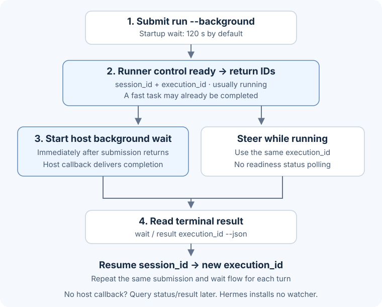

# Agent Pigeon

Delegate work to a coding agent, keep its conversation across turns, and send additional instructions while it runs. Use the same `pigeon` CLI from a terminal, Claude Code, Hermes, or another host.

[简体中文](README.zh-CN.md)

Choose the **host** where you ask for work and the **runner** that executes it independently. For example, Claude Code can delegate to Codex, and Hermes can delegate to Claude. Pigeon stores sessions, execution state, results, and collected history; integrations call the CLI.

## Install from a checkout

Requires **Node.js >=22.13**, npm, and an installed runner (`claude`, `codex`, or `hermes`). Process management primarily targets macOS/Linux. Node 22 may print an experimental SQLite warning.

```sh
npm install
npm link --workspace agent-pigeon
pigeon --help
pigeon capabilities --json
pigeon config validate --json
```

Run install/link at the repository root and keep the linked checkout in place. After `npm install`, you can also invoke `node /absolute/path/to/agent-pigeon/packages/cli/src/index.mjs ...` directly. The development install uses the local workspace; both `pigeon` and `agent-pigeon` commands are available.

## Run, steer, and collect a result

Start in the directory where the agent should work. Give it the task, relevant context, and success criteria:

```sh
pigeon run --runner codex --background --json -- "Review src and report defects"
```

The CLI waits for the runner's control channel to become ready, then returns `session_id`, `execution_id`, and `status`, usually `running`. A fast task can already return `completed`. Startup waits up to **120 seconds**, configurable with `PIGEON_STARTUP_TIMEOUT_MS` in milliseconds. Task execution continues in the background after startup.



Keep both IDs. A session (`pgs_...`) is the conversation; an execution (`pge_...`) is one turn. Replace these placeholders with the returned values:

```sh
# Agents: launch this immediately through the host's background task tool.
# In a terminal, this command waits until the execution reaches a terminal state.
pigeon wait pge_EXECUTION --json

# While it runs, send additional instructions to the same execution.
pigeon steer pge_EXECUTION --json -- "Prioritize the failing login tests"
pigeon messages pgs_SESSION -n 10

# Read the final result, then continue the conversation in a new execution.
pigeon result pge_EXECUTION --json
pigeon resume pgs_SESSION --background --json -- "Now add regression tests"
```

**Agent default:** immediately after a successful background run/resume returns, launch `wait EXECUTION --json` in a host background task, before ending the host turn. Claude Bash uses `run_in_background: true`; the waiter supplies the completion notification. Give the submission call enough time for startup plus overhead: **150 seconds by default**. A `running` response allows steer immediately, without readiness status polling. Read each control acknowledgment for its delivery state; a turn can finish before a new instruction arrives.

Use `status EXECUTION --json` for a snapshot, `cancel EXECUTION --json` to cancel, and `events EXECUTION --json` for recorded events. `messages` defaults to a concise history view; add `--raw` when structured history is needed. `events --follow` is a long-lived observer and belongs in a host background task.

Startup failures exit nonzero with error JSON. When an execution was created, top-level `session_id`, `execution_id`, and `status` let you inspect it. If a response is lost, inspect `pigeon executions --json` before retrying. For `unknown` outcomes, inspect the backend and events before retry/resume. Runner readiness replaces the earlier manager-started acknowledgment; final task success is reported by terminal status/result.

## Choose a route

Without a provider or preset, `--runner codex` uses the runner's existing authentication and configuration. To configure a service, create `$PIGEON_HOME/config.json` (default `~/.pigeon/config.json`):

```json
{
  "version": 2,
  "providers": {
    "service": {
      "protocols": ["openai-responses"],
      "base_url": {"openai-responses": "https://example.com/v1"},
      "api_key_env": "PIGEON_SERVICE_KEY"
    }
  },
  "presets": {
    "coding": {
      "provider": "service",
      "runner": "codex",
      "model": "REPLACE_WITH_REAL_MODEL_ID"
    }
  }
}
```

Replace the endpoint/model, set the named environment variable, and run `pigeon config validate --json`. Then submit with `pigeon run --preset coding --background --json -- "Your task"`. `--model` selects the actual backend model ID; `--preset` selects saved options. Explicit flags override preset values. Resume preserves the session's route and working directory.

Protocols are `anthropic-messages` for Claude, `openai-responses` for Codex, and `openai-chat-completions` for Hermes. Explicit unauthenticated providers (`auth.type: none`) currently work with Codex; use API-key or runner-managed authentication for Claude and Hermes. Capability output describes supported controls and limitations, while configuration validation checks route compatibility. See [configuration, authentication, states, and storage](docs/standalone.md) for details.

## Host integrations

| Host | Entry | Completion handling |
|---|---|---|
| Terminal/program | `pigeon` CLI | wait, events, status/result |
| Claude Code | [Claude plugin](integrations/claude-code) | submit, then immediately start host background wait |
| Hermes | [Hermes plugin](integrations/hermes) | `pigeon` tool and `/pigeon`; later status/result, or a separate host background waiter |
| Other skill-aware hosts | [Generic skill](integrations/skills/pigeon/SKILL.md) | host-supported background wait and callback |

Load the Claude plugin locally:

```sh
claude --plugin-dir /absolute/path/to/agent-pigeon/integrations/claude-code
```

Then use `/pigeon-standalone:pigeon run --preset coding -- TASK`. Copied/cached integrations need `pigeon` on PATH or `PIGEON_CLI` pointing to one executable/JS file. Ending a host conversation leaves shared Pigeon executions running; cancellation is explicit.

The Hermes host plugin installs no automatic watcher. Its run/resume transport timeout is startup timeout plus 30 seconds; other operations use 30 seconds. Hermes as a **runner** connects to an existing Gateway. `PIGEON_HERMES_ROOT` and `PIGEON_HERMES_PYTHON` override runner environment discovery. See [integration installation and checks](docs/integrations.md).

The CLI preserves the complete stored result through `result --json` and terminal `wait --json`. Status/messages are bounded previews. Hermes also marks truncation imposed by its host-response budget; use the direct CLI to retrieve the full stored result. Test coverage distinguishes local native-runner execution, simulated provider responses, and plugin loading/transport; see the guides for each check's scope.

## Legacy Claude plugin

The original root plugin, commands, scripts, hooks, and old jobs remain available. See [Legacy plugin documentation](docs/legacy-plugin.md).

```sh
claude plugin marketplace add luokinging/agent-pigeon
claude plugin install pigeon@pigeon-cc
```

This marketplace entry installs the legacy root plugin; `pigeon-cc` remains the marketplace name for compatibility. Standalone integrations live under `integrations/`. Legacy `/pigeon:run --session`, model aliases, IDs, and storage retain their original meaning. Use `pigeon legacy ...` from a complete checkout or the original scripts for old jobs. The standalone integrations leave shared tasks running when a host session ends; legacy cleanup hooks apply to legacy jobs.

## License

MIT
