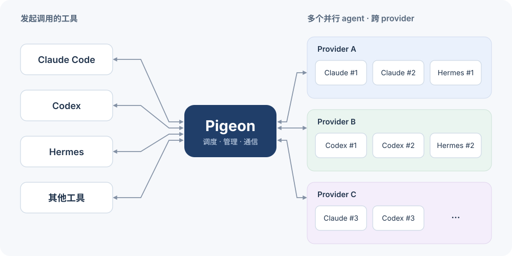

# Agent Pigeon

**让 agent 工具彼此调用，跨 provider 并行管理多个 agent。**

Claude Code、Codex、Hermes 都可以通过 Pigeon 发起任务，也可以成为任务的执行方。一个 agent 可以同时调用多个其他 agent，为它们选择不同的模型服务，查看进展、交换消息，并在完成后继续对话。

[English · README.md](README.md)

同一种工具可以同时运行多个实例。图中的 provider 分组展示一种配置示例，实际组合取决于工具支持的协议。

## 一个入口，多种 agent

| 能力 | 可以做什么 |
|---|---|
| **跨工具调用** | 从当前 agent 调用 Claude Code、Codex 或 Hermes，自由安排实现、审查和测试 |
| **并行执行** | 同时运行多个任务，也可以让同一种工具承担不同分工 |
| **跨 provider 配置** | 为任务选择服务商、模型和推理强度，或沿用工具已有配置 |
| **运行中通信** | 补充要求，让活动中的 agent 互相同步信息 |
| **持续会话** | 任务完成后沿用原上下文继续追问 |
| **统一管理** | 查看最近消息、获取结果、取消指定任务 |

Pigeon 负责连接和管理，实际工作由各个 agent 工具执行。每次调用的配置保留在对应执行范围内，不改动工具的全局设置。

## 开始使用

### 安装方法

将下面这句话粘贴到你使用的 agent 中：

> 查看 https://github.com/luokinging/agent-pigeon 并帮我安装 Pigeon。

选择你常用的接入方式。安装完成后，由当前 agent 操作 Pigeon，你在对话里描述任务即可。

| 接入方式 | 适合场景 | 安装说明 |
|---|---|---|
| **Skill** | 在 Codex 等支持 skill 的工具中使用，或让 agent 直接读取操作说明 | [docs/install.md#skill](docs/install.md#skill) |
| **Claude Code 插件** | 在 Claude Code 中安排任务、接收完成通知 | [docs/install.md#claude-code](docs/install.md#claude-code) |
| **Hermes 插件** | 在 Hermes 中调用和管理其他 agent | [docs/install.md#hermes](docs/install.md#hermes) |
| **CLI** | 脚本、终端或自定义集成 | [docs/install.md#cli](docs/install.md#cli) |

需要 Node.js 22.13+，以及本机已安装、配置好的执行工具。目前主要支持 macOS 和 Linux。当前版本通过源码安装，步骤集中在 [docs/install.md](docs/install.md)。

## 试一次并行协作

在已接入 Pigeon 的任意 agent 对话中提出需求：

> 用 Pigeon 同时安排三个任务：让一个 Codex 检查接口，另一个 Codex 检查测试，再让 Hermes 分析实现方案。它们都只做分析，最后把结果汇总给我。

需要不同模型服务时，先保存常用预设，再在任务中指定：

> 审查使用 review 预设，方案分析使用 research 预设，两边并行进行。

任务进行中，可以追加要求或安排互相交流：

> 告诉审查 agent 优先看登录流程。把两个审查 agent 的通信地址交给彼此，让它们直接同步发现。

完成后继续追问：

> 让刚才检查接口的 agent 根据发现提出修改方案。

当前 agent 负责分配任务、维护通信地址和收集结果。独立任务可以并行；修改同一份代码时，应安排好文件范围或独立工作目录。

## 支持的工具

| 工具 | 发起 Pigeon 调用 | 作为执行方 |
|---|---|---|
| Claude Code | 插件或 skill | 支持 |
| Codex | Skill 或 CLI | 支持 |
| Hermes | 插件或 CLI | 支持 |
| 其他 agent 工具 | 能读取 skill 并执行本地 CLI 时可接入 | 按 adapter 扩展 |

Claude Code 集成通过后台等待自动带回完成通知。Hermes 插件目前按需查询结果；其他接入方式使用所在工具的后台通知能力。

## 模型与 provider

可以直接使用执行工具已有的登录和默认模型，也可以显式指定 provider、模型和推理强度。预设把常用组合保存成一个名字，便于在不同任务中重复使用。

自定义端点目前支持：Claude Code 使用 Anthropic Messages，Codex 使用 OpenAI Responses，Hermes 使用 OpenAI Chat Completions。配置示例见 [docs/standalone.md#configuration](docs/standalone.md#configuration)。

## 文档

- 安装：[docs/install.md](docs/install.md)
- 插件与 skill：[docs/integrations.md](docs/integrations.md)
- 配置与命令参考：[docs/standalone.md](docs/standalone.md)
- Agent 操作说明：[integrations/skills/pigeon/SKILL.md](integrations/skills/pigeon/SKILL.md)
- 项目地址：https://github.com/luokinging/agent-pigeon

## 许可

MIT
